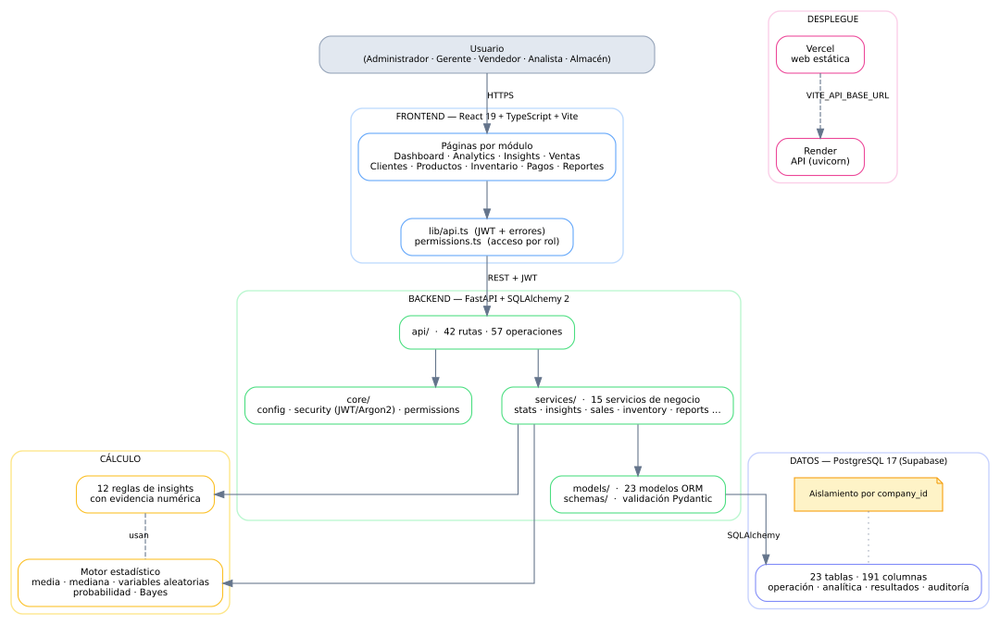
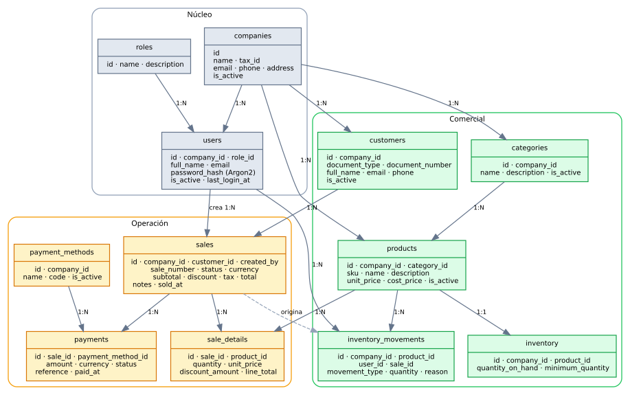
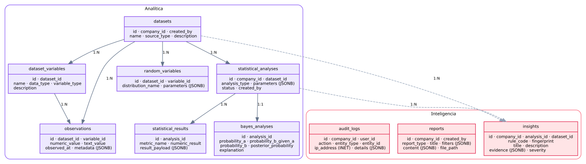
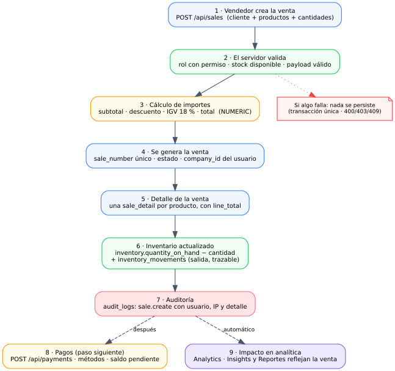

# Diagrama final — SalesIA Enterprise

> Representación completa del sistema construido. Versión 1.0 · Fase 16.
> Los diagramas están en `docs/img/` (formato SVG, editables con Graphviz).

## 1. Arquitectura general

Flor de capas desde el usuario hasta el despliegue, con el peso relativo de cada
componente: el frontend delega en la API, la API en los servicios, los servicios
en los modelos y el motor estadístico, y todo ello persiste en PostgreSQL
aislado por empresa.



**Recorrido de una petición**

1. El navegador renderiza la página y `lib/api.ts` añade el **JWT** del usuario.
2. FastAPI autentica el token y comprueba el **rol** en `core/permissions.py`.
3. El router valida la entrada con Pydantic y delega en el **servicio**.
4. El servicio aplica la lógica de negocio y, si procede, el **motor estadístico**.
5. El modelo ORM traduce la operación a SQL sobre **PostgreSQL**, siempre
   filtrando por `company_id`.

## 2. Modelo entidad-relación

Las 23 tablas del esquema, agrupadas por dominio. El detalle columna a columna
está en el [diccionario de datos](diccionario-datos.md).

### 2.1 Núcleo, comercial y operación

Las tablas que sostienen el día a día del negocio: la empresa y sus usuarios, el
catálogo, el inventario y el ciclo de venta-pago.



### 2.2 Analítica e inteligencia

Las tablas que alimentan el motor estadístico y guardan sus resultados, más la
auditoría.



| Bloque | Tablas |
|---|---|
| **Núcleo** | `companies`, `roles`, `users` |
| **Comercial** | `customers`, `categories`, `products`, `inventory`, `inventory_movements` |
| **Operación** | `sales`, `sale_details`, `payment_methods`, `payments` |
| **Analítica** | `datasets`, `dataset_variables`, `observations`, `random_variables`, `statistical_analyses`, `statistical_results`, `bayes_analyses` |
| **Inteligencia** | `insights`, `reports`, `audit_logs` |

**Relaciones clave**

- `companies` es la raíz: de ella cuelgan usuarios, clientes, catálogos y ventas.
- `sales` → `sale_details` → `products`: el detalle ata la venta a los productos.
- `sales` → `payments` (vía `payment_methods`): permite pagos parciales.
- `sales` → `inventory_movements`: **cada venta origina su salida de stock**,
  lo que da trazabilidad completa.
- `statistical_analyses` → `statistical_results` / `bayes_analyses`: los cálculos
  quedan almacenados y son consultables después.
- `insights` enlaza con análisis y datasets y guarda su **evidencia en JSONB**.

## 3. Flujo de una venta

El proceso crítico del sistema, de punta a punta. Es una **transacción única**:
si cualquier paso falla, no se persiste nada.



**Puntos de control**

| Paso | Control aplicado |
|---|---|
| 2 | Autorización por rol y validación de stock y payload |
| 3 | Cálculo de importes con decimal exacto (`NUMERIC`), IGV 18 % |
| 4 | `sale_number` único por empresa |
| 6 | Descuento atómico de stock + movimiento trazable |
| 7 | Registro en `audit_logs` con usuario, IP y detalle |

## 4. Seguridad y multiempresa

```
   Petición ──► JWT válido? ──► Rol autorizado? ──► company_id ──► Datos
                    │                │                  │
                  401              403            LIMITA la consulta
                                                     (siempre)
```

Tres barreras en cascada. La tercera es la más importante: **toda consulta pasa
por el `company_id` del usuario autenticado**, de modo que incluso un fallo de
autorización no exponería datos de otra empresa. Lo verifican los tests de
`test_datos.py` y el bloque 2 de la verificación de la Fase 13.

## 5. Entorno desplegado

```
  Usuario ──► https://salesia-enterprise-nine.vercel.app   (Vercel · React)
                        │  VITE_API_BASE_URL
                        ▼
             https://salesia-enterprise-brqr.onrender.com  (Render · FastAPI)
                        │  DATABASE_URL  (pooler, puerto 6543)
                        ▼
             Supabase · PostgreSQL 17.11                    (23 tablas)
```

- **CORS** restringido: la API sólo acepta el origen del frontend, declarado en
  `CORS_ORIGINS`.
- **Secretos** (`DATABASE_URL`, `JWT_SECRET_KEY`) sólo en variables de entorno.
- La **web** no guarda datos sensibles: el JWT vive en el almacenamiento del
  navegador y caduca a los 60 minutos.
